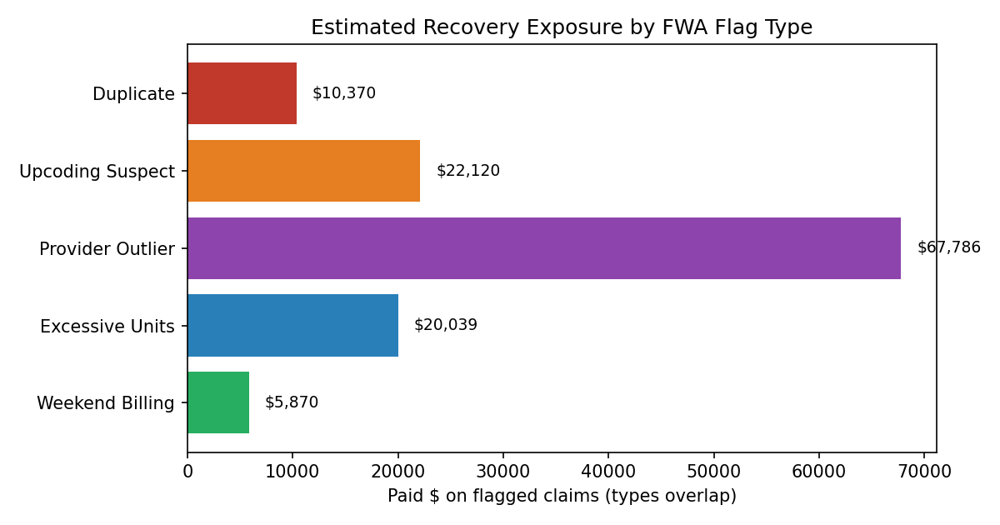
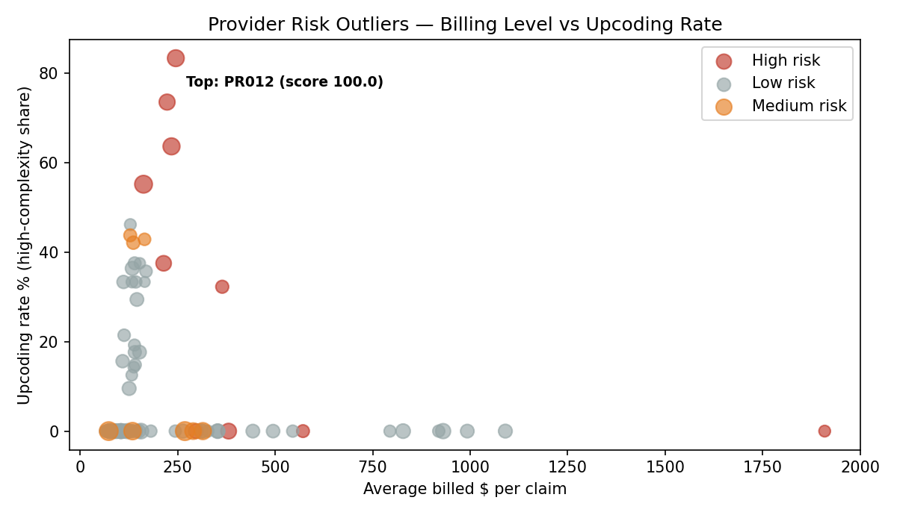
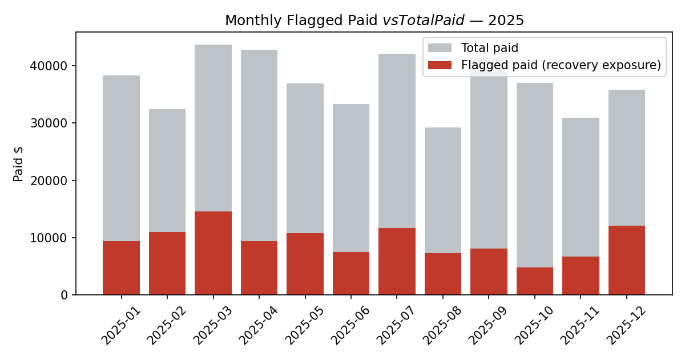
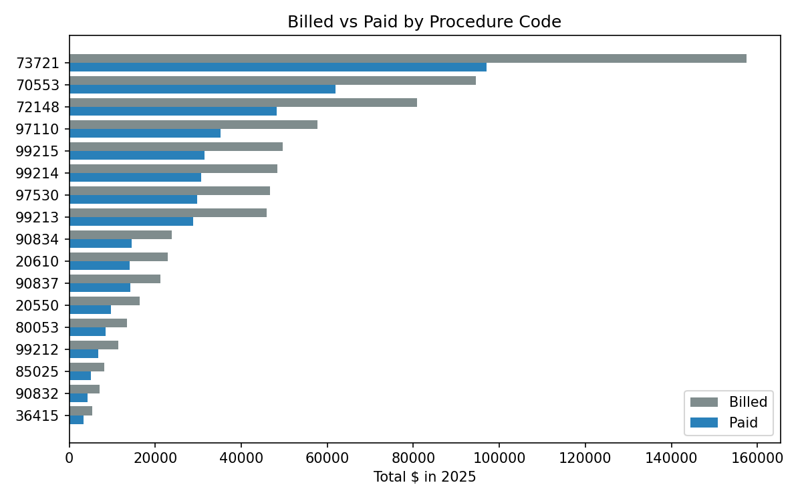

# Payment Integrity Analytics: Claims Fraud, Waste and Abuse (FWA) Detection

     

> **Portfolio project — synthetic data only, no PHI.** This project demonstrates payer-side **payment integrity** work: the analytics a health plan (or a vendor like Machinify) runs to find claims that should never have been paid — duplicate billings, upcoding, billing outliers, excessive units and weekend-billing anomalies — and to rank providers for investigation. All detection is **rule-based and reproducible**: there is no hidden answer key in the data; `analysis.py` finds the patterns with the same rules an analyst would write in SQL.

## Business problem

Health plans lose an estimated 3–10% of paid claims dollars to fraud, waste and abuse. Payment-integrity teams sit between claims adjudication and the Special Investigations Unit (SIU): they mine paid claims for billing patterns that violate policy or statistical norms, quantify the recovery exposure, and build provider risk rankings so investigators work the highest-value cases first. This project replicates that workflow end to end: **generate → detect → quantify → rank → present**.

## Detection rules (what the code actually does)

| # | Rule | Logic | Threshold |
|---|---|---|---|
| R1 | Duplicate billing | Same patient + provider + procedure + date + billed amount billed 2+ times; copies after the first are flagged | Exact match |
| R2 | Upcoding | Provider's high-complexity share (99215 / 90837) of E&M + Psychotherapy volume vs peers | ≥ max(30%, peer mean + 1.5 SD), ≥ 15 family claims |
| R3 | Provider outlier | Z-score of avg billed per claim / per patient computed **within specialty**; claims priced above 1.3× the procedure median are flagged | z > 2.0 |
| R4 | Excessive units | Therapy codes 97110/97530 billed with ≥ 6 units (typical session max is 4) | units ≥ 6 |
| R5 | Weekend billing | Provider weekend claim share far above the ~10% baseline | ≥ 35% with ≥ 25 claims |

Providers are then scored with a transparent composite **risk score (0–100)**: billing z-score, upcoding rate, weekend share, flagged share of their own claims, plus rule-hit points — and tiered High / Medium / Low.

## Headline KPIs (actual output of the run)

| KPI | Value |
|---|---|
| Total claims analyzed | 2,767 |
| Total billed / Total paid | $710,778 / $443,611 |
| **Flagged claims** | **454 (16.41%)** |
| **Estimated recovery exposure** | **$113,432** (paid $ on flagged claims) |
| Duplicate claims / paid on duplicates | 45 / $10,370 |
| Excessive-unit claims | 60 |
| Upcoding-suspect claims | 125 (4.52% of all claims) |
| Provider-outlier claims | 184 |
| Weekend-billing flagged claims | 71 |
| High-risk providers | 10 of 80 |
| Top risk provider | **PR012** (Primary Care, Northeast) — risk score 100/100, avg billed per claim $222.97 vs specialty peer median $94.20, upcoding rate 73.5% |

## Dashboard






## Key insights

- **16.4% of claims tripped at least one rule**, putting **$113,432 — about 26% of all paid dollars — into review**. That is the number a payment-integrity manager reports upward: exposure first, confirmed recovery after investigation.
- **Duplicates are the cleanest money**: 45 exact re-billings worth $10,370 paid. Highest precision, no clinical judgement needed, fastest to recover.
- **Outlier billing carries the biggest dollars** ($67,786 paid on outlier claims), ahead of upcoding suspects ($22,120) and excessive units ($20,039). One provider, PR012, bills high-complexity office visits for **73.5%** of its E&M volume — nearly triple the peer pattern — while also pricing above specialty peers.
- **Specialty-relative comparison matters**: a radiologist legitimately bills ~10× a primary-care visit, so every z-score in this project is computed *within specialty*. Comparing across specialties is the classic beginner mistake that floods investigators with false leads.
- **An outlier is a lead, not a verdict.** The correct next step for a High-tier provider is pre-payment review and medical-record requests — statistical evidence opens an investigation; it never proves fraud by itself.

## File tree

```
healthcare-payment-integrity-fwa/
├── README.md                  <- this file
├── analysis.py                <- the 5 detection rules + KPI engine
├── charts.py                  <- generates the 4 chart PNGs
├── requirements.txt
├── data_dictionary.md
├── LICENSE / .gitignore
├── data/        claims.csv (2,767), providers.csv (80)
├── sql/         analysis_queries.sql (10 queries mirroring the rules)
├── outputs/     kpi_summary.csv, insights.md, flagged_claims.csv, provider_risk_ranking.csv
├── images/      4 dashboard charts (PNG, from the actual data)
```

## How to run

```bash
pip install -r requirements.txt
python3 analysis.py          # runs all 5 rules -> outputs/   (prints the KPI table)
python3 charts.py            # -> images/ (4 PNGs)
```

## SQL highlights

`sql/analysis_queries.sql` implements the same detections in SQL: duplicates with `GROUP BY … HAVING COUNT(*) > 1` and a `ROW_NUMBER()` copy-rank, specialty-relative z-scores with window `AVG/STDDEV OVER (PARTITION BY specialty)`, `NTILE(4)` percentile quartiles, upcoding-rate aggregation, weekend-share with `EXTRACT(DAYOFWEEK …)`, and a monthly duplicate-exposure trend — the exact queries an analyst would run against a claims warehouse (BigQuery/Snowflake) before ever opening Python.

## 5 interview Q&A

**1. How is payment integrity different from claims denial management?**
Denials are claims the payer *rejected before payment* (missing info, coding errors, eligibility). Payment integrity is about money that *was paid but should not have been* — duplicates, upcoding, unbundling, billing outliers — and recovering it or stopping it pre-payment. Different data (paid claims), different goal (recovery + deterrence), different team (analytics + SIU).

**2. Why compute provider outliers within specialty instead of across all providers?**
Because legitimate price levels differ by an order of magnitude across specialties (an MRI vs an office visit). A global z-score flags almost every radiologist and misses a primary-care physician billing at 2.4× their true peers. Peer-group-relative statistics are what make a flag defensible when a provider disputes it.

**3. Your model flags a provider. Is that fraud?**
No. A flag is a statistical lead. Fraud requires intent, which only an investigation with medical records, contracts and interviews can establish. My job as the analyst is precision and documentation: reproducible rules, stated thresholds, and an audit trail from claim to flag — so investigators and legal can rely on the work.

**4. How would you measure whether these rules are any good?**
Precision and yield: of the claims flagged, what share do investigators confirm as improper (precision), and how many recovery dollars per reviewed claim (yield). Duplicates typically run near-100% precision; outlier rules run lower but carry larger dollars. Confirmed outcomes feed back to recalibrate thresholds — z > 2.0 and the 30% upcoding floor are starting points, not constants of nature.

**5. What would you add next with real payer data?**
Eligibility and authorization joins (was the service even covered/authorised?), procedure-code pair rules (unbundling, mutually exclusive codes), rendering-vs-billing provider and TIN-level rollups, place-of-service checks, and a supervised model trained on confirmed SIU outcomes once enough labelled cases exist — rules first, ML second, because rules are explainable in an appeal.

## 60-second talk track

"At CVS Health I worked on the reporting side of healthcare claims, so for this project I built the other side of the table — a payer payment-integrity engine. I generated 2,767 synthetic claims across 80 providers with realistic billing patterns, then wrote five detection rules: exact duplicate billing, upcoding measured as a provider's high-complexity share against peers, billing outliers using z-scores computed *within specialty*, excessive therapy units, and weekend-billing spikes. The engine flags 454 claims — 16.4% — and quantifies $113,432 of paid dollars as recovery exposure. Every provider gets a transparent 0-to-100 risk score; the top provider bills high-complexity visits at 73.5% of volume against a peer pattern near 25%, at more than double the specialty's median price. The outputs are exactly what an integrity team consumes: a flagged-claims worklist, a provider risk ranking, and a dashboard — plus the same detections written in SQL, because in a real plan this runs in the warehouse first. And the discipline I show in the README matters as much as the code: an outlier is an investigation lead, never an accusation."

## Next steps

Add authorization/eligibility joins and unbundling pair-rules; roll providers up to practice/TIN level; add an appeals-safe evidence pack per flag (claim history PDFs); pilot a gradient-boosting scorer on top of the rule flags once labelled outcomes exist.

---
*Portfolio project by Teja Pasupuleti. Synthetic data generated for demonstration; detection logic, SQL and analysis are production-pattern. MIT License.*
